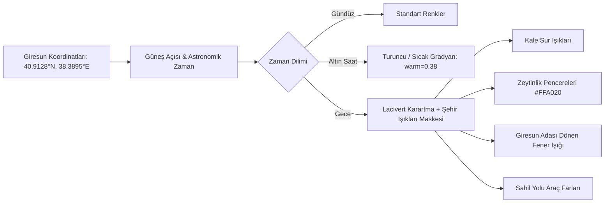

# 🌙 GECE ŞEHİR IŞIKLARI, MİNİK TRAFİK VE APPLE HIG SİSTEMİ

Bu belge, `tinydetroit.com`, `tinywarsaw.app` ve `tiny.london/world` projelerinden esinlenerek **Isometric Giresun** projesine entegre edilecek üç devrimsel sistemi kod seviyesinde modeller:

1. **Gece Modu & Şehir Işıkları (Night Mode & City Lights)**
2. **Minik Araç ve Tekne Trafik Motoru (Tiny Traffic & Marine Simulation)**
3. **Apple HIG (Human Interface Guidelines) Arayüz Mimarisi**

---

## 1. Gece Modu ve Şehir Işıkları (City Lights)

Giresun'un gecesi; kaleden denize vuran sarı sur ışıkları, Zeytinlik konaklarının pencerelerinden sızan sıcak kandil parıltıları ve Giresun Adası'ndaki tarihi deniz fenerinin dönen ışığıyla büyüleyicidir.



### A. Astronomik Güneş Pozisyonu Hesaplaması (TypeScript)
```typescript
// Giresun için gün doğumu ve gün batımı hesaplama
export function getGiresunSunTimes(date: Date = new Date()) {
  const LAT = 40.9128;
  const LON = 38.3895;
  // Basitleştirilmiş gün doğumu/batımı algoritması (dakika cinsinden)
  const dayOfYear = Math.floor((date.getTime() - new Date(date.getFullYear(), 0, 0).getTime()) / 86400000);
  const declination = 23.45 * Math.sin((360 / 365) * (dayOfYear - 81) * (Math.PI / 180));
  const hourAngle = Math.acos(-Math.tan(LAT * Math.PI / 180) * Math.tan(declination * Math.PI / 180)) * (180 / Math.PI);
  
  const solarNoon = 720 - 4 * LON - 120; // UTC+3 Türkiye saati
  const sunriseMinutes = solarNoon - hourAngle * 4;
  const sunsetMinutes = solarNoon + hourAngle * 4;

  const currentMinutes = date.getHours() * 60 + date.getMinutes();
  
  if (currentMinutes < sunriseMinutes - 45 || currentMinutes > sunsetMinutes + 45) return "Night";
  if (currentMinutes < sunriseMinutes + 20) return "Dawn";
  if (currentMinutes < sunriseMinutes + 120) return "Morning";
  if (currentMinutes < sunsetMinutes - 60) return "Day";
  if (currentMinutes < sunsetMinutes) return "Evening";
  return "Dusk";
}
```

### B. Gece Şehir Işıkları Maskesi ve Shader Katmanı
Gece olduğunda taban görsel hafif laciverte çalar (`brightness(0.85) saturate(0.5) contrast(0.95)`). Ardından ışık yayan pikseller (Emissive Mask) `mix-blend-mode: screen` ile parıldatılır:
- **Kale Burçları**: `#FFD166` altın sarısı projektör aydınlatması.
- **Zeytinlik Evleri**: Pencerelerden dışarı sızan sıcak tungsten ışıklar (`rgba(255, 176, 59, 0.9)`).
- **Giresun Adası Feneri**: 360 derece dönen, denizi tarayan konik ışık huzmesi (`beamCone`).

---

## 2. Minik Araç ve Tekne Trafik Sistemi (Tiny Vehicles)

`tinywarsaw.app` ve `tinydetroit.com`'daki gibi haritaya hayat veren hareketli unsurlar:

### A. Karadeniz Sahil Yolu Trafiği (Spline Path)
- **Araç Türleri**: Sarı şehir içi dolmuşlar, otomobiller, Karadeniz otobüsleri.
- **Gündüz**: Küçük renkli pikseller şerit boyunca akıcı hızla ilerler.
- **Gece**: Her aracın önünde sarı/beyaz **iki adet konik far huzmesi (headlights)**, arkasında ise kırmızı **stop lambası izleri (taillights)** belirir!

```typescript
export interface TinyVehicle {
  id: string;
  type: "car" | "dolmus" | "bus" | "taka";
  x: number;
  y: number;
  speed: number;
  direction: 1 | -1; // Doğu (Trabzon) veya Batı (Ordu) yönü
  lightIntensity: number;
}
```

### B. Karadeniz Balıkçı Takaları ve Ada Gezi Tekneleri
- **Güzergâh**: Giresun Limanı $\leftrightarrow$ Giresun Adası arası.
- **Efekt**: Tekne ilerlerken arkasında iki yana açılan beyaz köpük dalgacıkları (V-şekilli wake foam).
- **Gece**: Tekne tepesinde yanıp sönen yeşil/kırmızı seyir fenerleri (nav lights).

### C. Giresun Semalarında Martılar (Seagulls)
- Giresun Kalesi ve Ada çevresinde süzülen 2-4 piksellik kanat çırpan beyaz martılar.

---

## 3. Apple Human Interface Guidelines (HIG) Arayüz Tasarımı

`tinywarsaw.app`'te gördüğümüz Apple zarafetini projemize aktarıyoruz:

### A. Yüzen Buzlu Cam Dock (Floating Frosted Glass Dock)
Ekranın altında macOS / iPadOS dock'u gibi yüzen, köşeleri yuvarlatılmış (squircle) panel:

```css
/* Apple HIG Frosted Glass Dock */
.apple-dock {
  position: fixed;
  bottom: calc(16px + env(safe-area-inset-bottom));
  left: 50%;
  transform: translateX(-50%);
  z-index: 100;
  
  display: flex;
  align-items: center;
  gap: 8px;
  padding: 6px 12px;
  
  background: rgba(255, 255, 255, 0.75);
  backdrop-filter: blur(24px) saturate(180%);
  -webkit-backdrop-filter: blur(24px) saturate(180%);
  
  border: 1px solid rgba(255, 255, 255, 0.35);
  border-radius: 20px;
  box-shadow: 0 8px 32px rgba(0, 0, 0, 0.12), 0 2px 8px rgba(0, 0, 0, 0.06);
}

/* Koyu Mod Desteği */
@media (prefers-color-scheme: dark), body.dark-mode {
  .apple-dock {
    background: rgba(20, 26, 34, 0.78);
    border: 1px solid rgba(255, 255, 255, 0.12);
    box-shadow: 0 12px 40px rgba(0, 0, 0, 0.45);
  }
}

/* Apple 44px Dokunma Standardı */
.dock-button {
  min-width: 44px;
  min-height: 44px;
  padding: 8px 14px;
  border-radius: 12px;
  border: none;
  background: transparent;
  color: #1d1d1f;
  font-family: -apple-system, BlinkMacSystemFont, "SF Pro Text", system-ui, sans-serif;
  font-size: 13px;
  font-weight: 500;
  cursor: pointer;
  transition: all 0.2s cubic-bezier(0.25, 1, 0.5, 1);
}

.dock-button:hover {
  background: rgba(0, 0, 0, 0.06);
  transform: translateY(-2px);
}

.dock-button.active {
  background: #0071e3; /* Apple Sistem Mavisi */
  color: #ffffff;
  box-shadow: 0 2px 8px rgba(0, 113, 227, 0.35);
}
```

### B. Üst Durum Çubuğu (Dynamic Status Capsule)
Sol üstte yer alan, iOS Dinamik Ada estetiğinde hap şeklinde durum rozeti:
- **Giresun Yerel Saati**: Canlı akan saat (`14:25` veya gece `22:15`).
- **Canlı Hava Rozeti**: ☀️ 18°C Güneşli / ❄️ 2°C Kar Yağışlı.
- **Rüzgâr Göstergesi**: ↗️ Poyraz 14 knot.
- **Mevsim Geçişi**: Tek tıkla 🌿 Yaz $\leftrightarrow$ ❄️ Kış modu.

---

## 4. Kullanıcı Deneyimi (UX) Özeti

Bu üç sistem birleştiğinde **Isometric Giresun** sıradan bir harita olmaktan çıkıp:
1. **Gündüz**: Fındık bahçeleri üzerinde martılar uçuşur, denizde takalar süzülür, sahil yolunda araçlar akar.
2. **Kış / Kar Modu**: Kar taneleri poyraz rüzgârıyla savrulurken kale ve çatılar beyaza bürünür.
3. **Gece Modu**: Güneş battığında kale surları altın sarısı projektörlerle aydınlanır, Zeytinlik konaklarının pencereleri parıldar, araçların farları sahil yolunu aydınlatır ve ada feneri 360° döner.
4. **Kontrol**: Tüm bu büyü, ekranın altındaki zarif **Apple HIG cam dock'u** üzerinden parmak uçlarıyla yönetilir!
