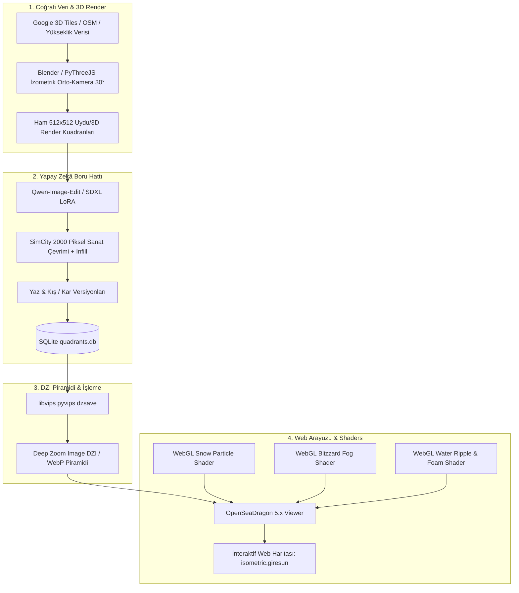

# 🏔️ ISOMETRIC GIRESUN (İzometrik Giresun)

> **90'lar SimCity 2000 & RollerCoaster Tycoon Estetiğinde, Yapay Zekâ Destekli, Gerçekçi Coğrafi Veriye Dayalı İnteraktif Karadeniz Şehir Haritası.**  
> İlham Kaynağı: [isometric.nyc](https://isometric.nyc) (Andy Coenen / @cannoneyed)

---

## 🎯 Projenin Vizyonu

**Isometric Giresun**, Karadeniz'in incisi Giresun'un tarihi yarımadasını, volkanik kaya üzerindeki heybetli **Giresun Kalesi**'ni, mitolojik **Giresun Adası**'nı, taş konaklarıyla meşhur **Zeytinlik Mahallesi**'ni, yemyeşil fındık bahçelerini ve hırçın Karadeniz sahilini 16-bit / 32-bit izometrik piksel sanatı formunda canlandıran devasa, etkileşimli bir web harita projesidir.

Tıpkı `isometric.nyc`'de olduğu gibi; harita elle tek tek çizilmek yerine:
1. **Gerçek 3D Coğrafi Veri** (Google 3D Tiles / OpenStreetMap / DEM yükseklik haritası)
2. **Özel Eğitilmiş Generative AI Modelleri** (Qwen-Image-Edit Infill, LoRA stil aktarımı)
3. **Kare Bazlı Dikişsiz Birleştirme Motoru** (Quadrant Stitching Rules & libvips DZI piramidi)
4. **Yüksek Performanslı Web Görüntüleyici** (OpenSeaDragon + React + WebGL Shader Katmanları)

kullanılarak inşa edilir.

---

## ❄️ Öne Çıkan Özellik: "Karadeniz Kışı" (Snow Mode)

`isometric.nyc`'nin en büyüleyici özelliği olan **Snow Mode**, Giresun projemizin kalbinde yer alır:
- **Kış DZI Doku Katmanı**: Kalenin surları, zeytinlik konaklarının kiremit çatıları, fındık ocakları ve sahil şeridi beyaz karlar altında!
- **WebGL Kar Parçacık Motoru (GPU Shaders)**: Ekrana göre ölçeklenen (5.000–15.000 parçacık), rüzgâr salınımlı, derinlik perspektifli gerçek zamanlı kar yağışı.
- **Kar Fırtınası & Sis Efekti (Blizzard Haze)**: Karadeniz'in kış fırtınalarını hissettiren mavimsi-gri atmosferik sis örtüsü.
- **Dinamik Dalga & Köpük Shader'ı (Water Shader)**: Sahile ve Giresun Adası kayalıklarına vuran köpüklü canlı dalgalar.

---

## 📚 Dokümantasyon Rehberi

Detaylı teknik analiz ve uygulama planları aşağıdaki modüler dosyalara çıkarılmıştır:

| Dosya | Açıklama |
|---|---|
| [01_ISOMETRIC_NYC_ARASTIRMASI.md](file:///Users/hayrullah/Documents/GitHub/Game%20Serisi/Game.ISOMETRIK/01_ISOMETRIC_NYC_ARASTIRMASI.md) | `isometric.nyc`'nin derin mimari incelemesi, açık kaynak kodları, veri akışı ve püf noktaları. |
| [02_SNOW_MODE_VE_SHADERLAR.md](file:///Users/hayrullah/Documents/GitHub/Game%20Serisi/Game.ISOMETRIK/02_SNOW_MODE_VE_SHADERLAR.md) | Snow Modunun sırrı: Çift DZI katmanı, GLSL Kar Parçacık Shader'ı, Sis ve Dalga efektleri kodları. |
| [03_GIRESUN_KONSEPT_VE_HARITA_PLANI.md](file:///Users/hayrullah/Documents/GitHub/Game%20Serisi/Game.ISOMETRIK/03_GIRESUN_KONSEPT_VE_HARITA_PLANI.md) | Giresun'un odak noktaları (Kale, Ada, Zeytinlik, Liman, Gedikkaya), GPS koordinatları ve 2:1 grid ızgarası. |
| [04_AI_URETIM_BORUHATTI_PIPELINE.md](file:///Users/hayrullah/Documents/GitHub/Game%20Serisi/Game.ISOMETRIK/04_AI_URETIM_BORUHATTI_PIPELINE.md) | 3D veri yakalama, yapay zekâ inpainting, dikiş (seam) önleme kuralları ve libvips DZI ihracı. |
| [05_WEB_MIMARISI_VE_FRONTEND.md](file:///Users/hayrullah/Documents/GitHub/Game%20Serisi/Game.ISOMETRIK/05_WEB_MIMARISI_VE_FRONTEND.md) | Bun + Vite + React + TypeScript + OpenSeaDragon web mimarisi, kontroller ve ses atmosferi. |
| [06_YOL_HARITASI_VE_GOREVLER.md](file:///Users/hayrullah/Documents/GitHub/Game%20Serisi/Game.ISOMETRIK/06_YOL_HARITASI_VE_GOREVLER.md) | Adım adım üretim fazları (MVP'den tam sürüme), araç listesi ve yapılacak işler listesi. |
| [07_DETROIT_WARSAW_VE_DUNYA_ORNEKLERI.md](file:///Users/hayrullah/Documents/GitHub/Game%20Serisi/Game.ISOMETRIK/07_DETROIT_WARSAW_VE_DUNYA_ORNEKLERI.md) | `tinydetroit.com`, `tiny.london/world` ve `tinywarsaw.app` analizi; küresel izometrik harita hareketinin kazanımları. |
| [08_GECE_MODU_TRAFIK_VE_APPLE_HIG.md](file:///Users/hayrullah/Documents/GitHub/Game%20Serisi/Game.ISOMETRIK/08_GECE_MODU_TRAFIK_VE_APPLE_HIG.md) | Gece şehir ışıkları, dönen ada feneri, sahil yolu araç farları, balıkçı takaları ve Apple HIG cam dock arayüzü. |
| [09_HGM_ATLAS_PLAYWRIGHT_VE_3D_VERI_YAKALAMA.md](file:///Users/hayrullah/Documents/GitHub/Game%20Serisi/Game.ISOMETRIK/09_HGM_ATLAS_PLAYWRIGHT_VE_3D_VERI_YAKALAMA.md) | Harita Genel Müdürlüğü (HGM) Atlas ortofoto servisleri, Playwright ile 4K yakalama ve 3B modelleme stratejisi. |
| [10_APPLE_HIG_HATA_DUZELTME_VE_UI_KURALLARI.md](file:///Users/hayrullah/Documents/GitHub/Game%20Serisi/Game.ISOMETRIK/10_APPLE_HIG_HATA_DUZELTME_VE_UI_KURALLARI.md) | Apple HIG arayüz düzeni, kapatılma/gizlenme hata çözümleri, z-index hiyerarşisi ve çakışma önleme standartları. |
| [11_GIRESUN_IL_SINIRI_VE_KARARTMA_MASKESI.md](file:///Users/hayrullah/Documents/GitHub/Game%20Serisi/Game.ISOMETRIK/11_GIRESUN_IL_SINIRI_VE_KARARTMA_MASKESI.md) | Giresun il sınırları dışını karartan GPU ters maskesi, neon kenarlık ışığı ve dinamik gün ışığı entegrasyonu. |
| [12_LANDMARK_VE_DOGRULANMIS_LOKASYONLAR.md](file:///Users/hayrullah/Documents/GitHub/Game%20Serisi/Game.ISOMETRIK/12_LANDMARK_VE_DOGRULANMIS_LOKASYONLAR.md) | Apple HIG cam modal / sheet tasarımı, 16 ilçenin ve simge yapıların doğrulanmış kesin GPS koordinatları. |
| [13_CANLI_DUNYA_GECE_ISIK_TRAFIK_3B.md](file:///Users/hayrullah/Documents/GitHub/Game%20Serisi/Game.ISOMETRIK/13_CANLI_DUNYA_GECE_ISIK_TRAFIK_3B.md) | Gece/gündüz döngüsü, yanan bina pencereleri, sokak parıltısı ve canlı araç/tekne trafiği motoru. |
| [14_GERCEK_AYAK_IZLERI_VE_3D_YAPILAR.md](file:///Users/hayrullah/Documents/GitHub/Game%20Serisi/Game.ISOMETRIK/14_GERCEK_AYAK_IZLERI_VE_3D_YAPILAR.md) | HGM ortofoto ile %100 örtüşen 6.691 gerçek bina ayak izi (Duroğlu ve Giresun merkez dahil) ve 3B ekstrüzyon mimarisi. |

---

## 🛠️ Temel Teknoloji Yığını (Tech Stack)



---

## 🚀 Hızlı Başlangıç (Port Kontrollü Otomatik Başlatıcı)

Projeyi tek tıkla veya tek bir komutla ayağa kaldırabilirsiniz. Hazırlanan **port kontrollü başlatıcı**:
- `5173` portunun dolu olup olmadığını denetler, doluysa eski takılı süreci temizler.
- `node_modules` eksikse otomatik kurar.
- Tarayıcıyı `http://localhost:5173/` adresinde otomatik açar ve sunucuyu başlatır.

### macOS Finder'dan:
Proje klasöründeki **[`start.command`](file:///Users/hayrullah/Documents/GitHub/Game%20Serisi/Game.ISOMETRIK/start.command)** dosyasına çift tıklamanız yeterlidir!

### Terminalden:
```bash
./start.command
# veya
./start.sh
# veya
npm start
```
